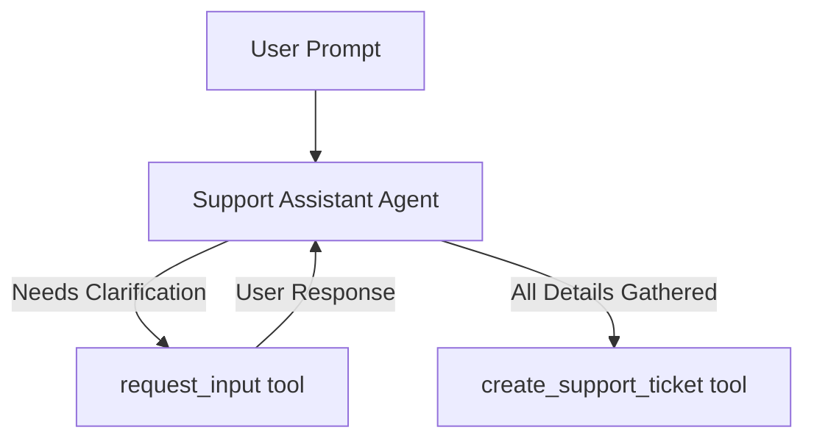

# Request Input Tool Sample

## Overview

This sample demonstrates how an LLM agent can proactively request clarification or confirmation from the user using the built-in `request_input` tool without losing its context/flow.

It showcases a highly realistic support assistant that dynamically constructs a JSON schema to only ask for missing details when creating IT support tickets.

## Sample Inputs

- `I want to file a technical ticket for a database crash.`

  The agent will analyze the prompt, identify that the `title` and `category` are already provided, and dynamically call `request_input` with a schema requesting only `description` and `priority`.

- `File a priority HIGH technical ticket titled database crash explained as the MySQL server throwing OOM errors.`

  The agent has all required details and will call `create_support_ticket` immediately without needing clarification.

## Graph



## How To

This sample uses **Pattern B: Standalone Agents** with the `request_input` tool:

1. **Import `request_input`**:

   ```python
   from google.adk.tools import request_input
   ```

1. **Add it to the LLM Agent's tools list**:

   ```python
   root_agent = Agent(
       name="support_assistant_agent",
       tools=[create_support_ticket, request_input],
       ...
   )
   ```

When the LLM decides it needs clarification, it calls `request_input` with a question and a dynamic `response_schema`. The ADK framework automatically intercepts this, yields a long-running interrupt to the client, and injects the user's reply back as a `FunctionResponse` into the LLM's chat history.

## Weilliptic setup and usage

This recipe uses the [`weil-ai`](https://pypi.org/project/weil-ai/) package. Run the commands below from this folder.

### Setup

1. Install the dependencies:

   ```bash
   uv sync
   ```

2. Create the env file and fill in the values:

   ```bash
   cp .env.example .env
   ```

   Variables you must set: `WEIL_AGENT_IDENTITY`, `OPENAI_API_KEY`. The other variables in the file have working defaults.

3. Put your values in `.env`. Only these need to change; leave the rest as they are:

   ```dotenv
   WEIL_AGENT_IDENTITY=weil_<your-identity>
   OPENAI_API_KEY=<your-openai-api-key>
   ```

   `WEIL_AGENT_IDENTITY` must be a real Weilliptic identity; the placeholder `weil_xxxx` is rejected. `WEIL_SERVICE` (default `engg.acme`) and `AGENT_MODEL` (default `openai/gpt-4o`) can be overridden in `.env`; they are read in `app/config.py`.

4. If your Sentinel node is not at the default address, also add its URL to `.env`:

   ```dotenv
   SENTINEL_HOST=<your-sentinel-url>
   ```

5. Enable the agent import. In `app/__init__.py`, uncomment `from . import agent` and add a noqa for E402:

   ```python
   load_dotenv()
   from . import agent  # noqa: E402 -- must come after load_dotenv()
   ```

### Environment variables

Set these in `.env`; everything else has a working default.

| Variable | Description |
| :-- | :-- |
| `WEIL_AGENT_IDENTITY` | Weilliptic identity of the agent (`weil_<token>`). |
| `OPENAI_API_KEY` | OpenAI API key, read by LiteLLM for `openai/...` models. |

### Run locally

```bash
uv run adk web
```

Open <http://localhost:8000> and pick `app` from the agent list.

### Run with Docker

```bash
docker build -t weil-request-input-tool .
grep -vE '^\s*(#|$)|<TODO' .env | sed -E 's/[[:space:]]+#.*$//' > .env.docker
docker run --rm --env-file .env.docker -p 8080:8080 weil-request-input-tool
```

Open <http://localhost:8080/dev-ui/> and pick `app`. `.env.docker` is `.env` without comments (Docker's `--env-file` does not strip them) and is git-ignored. Credentials are never copied into the image; they come from `--env-file` at run time.

### A2A server

The agent also builds a Weil-secured A2A app, `a2a_app`, which rejects requests that do not carry valid Weil signature headers. It advertises port 8009:

```bash
docker run --rm --env-file .env.docker -p 8009:8009 weil-request-input-tool \
  uv run uvicorn app.agent:a2a_app --host 0.0.0.0 --port 8009
```
