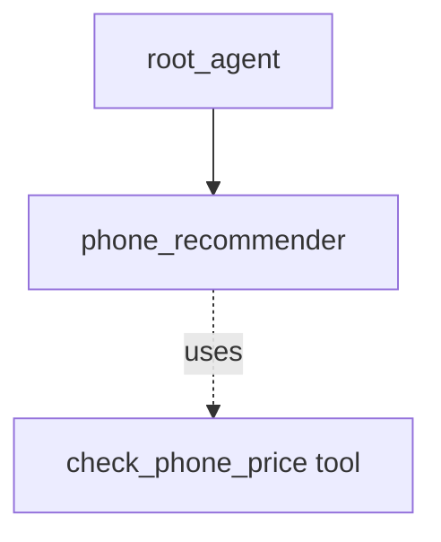

# ADK Single-turn Agent as Sub-agent Sample

## Overview

This sample demonstrates how a "single_turn" mode agent can act as an autonomous sub-agent to an LLM agent, utilizing schemas and tools without ever interacting with the user.

**Note**: This is the recommended mechanism to replace the older `AgentTool` pattern. Unlike `AgentTool`, using a `single_turn` sub-agent preserves the sub-agent's internal interactions (like tool calls) in the session history.

Single-turn agents are designed to execute their function fully in one prompt-response cycle. In this sample:

1. `phone_recommender`: A single-turn agent that receives structured input (`UserPreferences`), uses a mocked tool (`check_phone_price`), and returns structured output (`PhoneRecommendation`).
1. `root_agent`: The main agent that interacts with the user, translates their natural language request into the structured `UserPreferences`, and delegates to `phone_recommender`.

## Sample Inputs

- `I need a phone mostly for gaming. I have about $1000 to spend.`

- `What is a good cheap phone from Google for basic tasks?`

- `I love photography but prefer smaller phones. My budget is $600.`

## Graph



## How To

1. Define a sub-agent with `mode="single_turn"`, `input_schema`, `output_schema`:

   ```python
   phone_recommender = Agent(
       name="phone_recommender",
       mode="single_turn",
       input_schema=UserPreferences,
       output_schema=PhoneRecommendation,
       tools=[check_phone_price],
       ...
   )
   ```

1. Assign it to a parent agent:

   ```python
   root_agent = Agent(
       sub_agents=[phone_recommender],
       ...
   )
   ```

## Related Guides

- [LlmAgent Single-Turn Mode](../../../../docs/guides/agents/llm_agent/single_turn.md) - Guide explaining the behavior and configuration of single-turn agents.

## Weilliptic setup and usage

This recipe uses the [`weil-ai`](https://pypi.org/project/weil-ai/) package. Run the commands below from this folder.

### Setup

1. Install the dependencies:

   ```bash
   uv sync
   ```

2. Create the env file and fill in the values:

   ```bash
   cp .env.example .env
   ```

   Variables you must set: `OPENAI_API_KEY`. The other variables in the file have working defaults.

3. Replace the placeholder `identity="weil_xxxx"` in `app/agent.py` with your own Weilliptic identity. It is hardcoded there, and WeilChain rejects the placeholder at startup. See [Generate an agent identity](../weilliptic-integration/README.md#generate-an-agent-identity).

### Run locally

```bash
uv run adk web
```

Open <http://localhost:8000> and pick `app` from the agent list.

### Run with Docker

```bash
docker build -t weil-single-turn-sub-agent .
docker run --rm --env-file .env -p 8080:8080 weil-single-turn-sub-agent
```

The image serves the app on port 8080 (`/list-apps` lists it). Credentials are never copied into the image; they come from `--env-file` at run time.

### A2A server

The agent also builds a Weil-secured A2A app, `a2a_app`, which rejects requests that do not carry valid Weil signature headers. It advertises port 8003:

```bash
docker run --rm --env-file .env -p 8003:8003 weil-single-turn-sub-agent \
  uv run uvicorn app.agent:a2a_app --host 0.0.0.0 --port 8003
```

See the [Weilliptic integration guide](../weilliptic-integration/README.md) for how the security hooks work.
