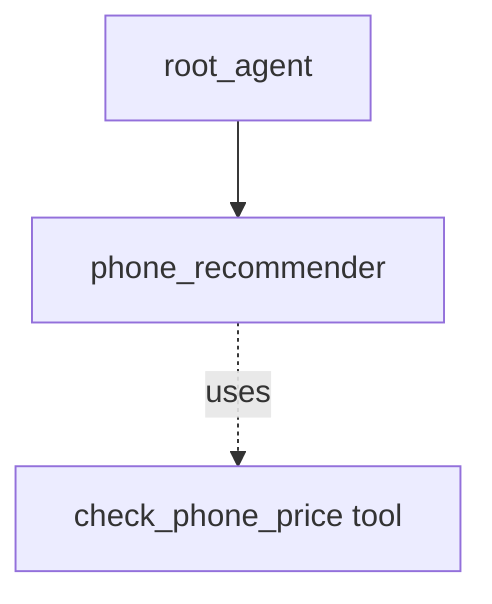

# ADK Single-turn Agent as Sub-agent Sample

## Overview

This sample demonstrates how a "single_turn" mode agent can act as an autonomous sub-agent to an LLM agent, utilizing schemas and tools without ever interacting with the user.

**Note**: This is the recommended mechanism to replace the older `AgentTool` pattern. Unlike `AgentTool`, using a `single_turn` sub-agent preserves the sub-agent's internal interactions (like tool calls) in the session history.

Single-turn agents are designed to execute their function fully in one prompt-response cycle. In this sample:

1. `phone_recommender`: A single-turn agent that receives structured input (`UserPreferences`), uses a mocked tool (`check_phone_price`), and returns structured output (`PhoneRecommendation`).
1. `root_agent`: The main agent that interacts with the user, translates their natural language request into the structured `UserPreferences`, and delegates to `phone_recommender`.

## Sample Inputs

- `I need a phone mostly for gaming. I have about $1000 to spend.`

- `What is a good cheap phone from Google for basic tasks?`

- `I love photography but prefer smaller phones. My budget is $600.`

## Graph



## How To

1. Define a sub-agent with `mode="single_turn"`, `input_schema`, `output_schema`:

   ```python
   phone_recommender = Agent(
       name="phone_recommender",
       mode="single_turn",
       input_schema=UserPreferences,
       output_schema=PhoneRecommendation,
       tools=[check_phone_price],
       ...
   )
   ```

1. Assign it to a parent agent:

   ```python
   root_agent = Agent(
       sub_agents=[phone_recommender],
       ...
   )
   ```

## Related Guides

- [LlmAgent Single-Turn Mode](../../../../docs/guides/agents/llm_agent/single_turn.md) - Guide explaining the behavior and configuration of single-turn agents.

## Weilliptic setup and usage

This recipe uses the [`weil-ai`](https://pypi.org/project/weil-ai/) package. Run the commands below from this folder.

### Prerequisites

Before you run this recipe you need to set up your organization, create a subgroup and generate an agent identity. This is a one-time setup; follow the [Org onboarding guide](https://docs.weilliptic.ai/docs/org-onboarding/) and keep these steps in order:

1. **Set up your org and identity** ([guide](https://docs.weilliptic.ai/docs/org-onboarding/identity-setup)). Log in at console.weilliptic.ai with a connected wallet, open **Admin Panel** and the **Setup Identity** tab. Enter your org's TLD (the guide uses `acme`), keep the default **Key Management** and **Identity** applets, pick the pods (SENATE is always included) and click **Register Organization**, approving each wallet prompt. Then, in the WeilWallet extension, open **Account Details**, click **Link Organization**, select your org, and click **I've linked it — Continue** back in the console.
2. **Create a subgroup** ([guide](https://docs.weilliptic.ai/docs/org-onboarding/team-onboarding)). On the master pod's **Onboard Team** tab, click **Create Subgroup** and fill in the team name, team admin address, admin name and designation. You get a subgroup such as `engg.acme`.
3. **Add an agent** ([guide](https://docs.weilliptic.ai/docs/org-onboarding/add-agents)). With your org selected as the active organization in WeilWallet, click **Add Agent**, enter a name, a description and a purpose (the guide uses "Execution"), and pick the subgroup. When registration finishes, the agent's identity and wallet address are shown **once**; copy the identity.

Put the identity in `WEIL_AGENT_IDENTITY` (see [Setup](#setup)). `WEIL_SERVICE` defaults to `engg.acme`, the example subgroup in the guide; set it to your own subgroup if you named it differently.

The identity is a live credential: anyone who has it can sign as the agent. Keep it in `.env` and never commit it.

### Setup

1. Install the dependencies:

   ```bash
   uv sync
   ```

2. Create the env file and fill in the values:

   ```bash
   cp .env.example .env
   ```

   Variables you must set: `WEIL_AGENT_IDENTITY`, `OPENAI_API_KEY`. The other variables in the file have working defaults.

3. Put your values in `.env`. Only these need to change; leave the rest as they are:

   ```dotenv
   WEIL_AGENT_IDENTITY=weil_<your-identity>
   OPENAI_API_KEY=<your-openai-api-key>
   ```

   `WEIL_AGENT_IDENTITY` must be a real Weilliptic identity; the placeholder `weil_xxxx` is rejected. `WEIL_SERVICE` (default `engg.acme`) and `AGENT_MODEL` (default `openai/gpt-4o`) can be overridden in `.env`; they are read in `app/config.py`.

4. If your Sentinel node is not at the default address, also add its URL to `.env`:

   ```dotenv
   SENTINEL_HOST=<your-sentinel-url>
   ```

5. Enable the agent import. In `app/__init__.py`, uncomment `from . import agent` and add a noqa for E402:

   ```python
   load_dotenv()
   from . import agent  # noqa: E402 -- must come after load_dotenv()
   ```

### Environment variables

Set these in `.env`; everything else has a working default.

| Variable | Description |
| :-- | :-- |
| `WEIL_AGENT_IDENTITY` | Weilliptic identity of the agent (`weil_<token>`). |
| `OPENAI_API_KEY` | OpenAI API key, read by LiteLLM for `openai/...` models. |

### Run locally

```bash
uv run adk web
```

Open <http://localhost:8000> and pick `app` from the agent list.

### Run with Docker

```bash
docker build -t weil-single-turn-sub-agent .
grep -vE '^\s*(#|$)|<TODO' .env | sed -E 's/[[:space:]]+#.*$//' > .env.docker
docker run --rm --env-file .env.docker -p 8080:8080 weil-single-turn-sub-agent
```

Open <http://localhost:8080/dev-ui/> and pick `app`. `.env.docker` is `.env` without comments (Docker's `--env-file` does not strip them) and is git-ignored. Credentials are never copied into the image; they come from `--env-file` at run time.

### A2A server

The agent also builds a Weil-secured A2A app, `a2a_app`, which rejects requests that do not carry valid Weil signature headers. It advertises port 8003:

```bash
docker run --rm --env-file .env.docker -p 8003:8003 weil-single-turn-sub-agent \
  uv run uvicorn app.agent:a2a_app --host 0.0.0.0 --port 8003
```
