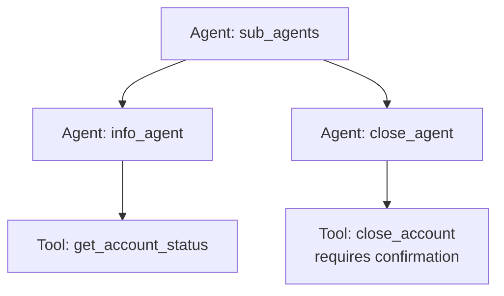

# ADK Agent Sub-Agents Sample

## Overview

This sample demonstrates how to create a hierarchical agent setup using sub-agents in the **ADK** framework, and also showcases how to use tool confirmation.

It defines a root `Agent` named `sub_agents` that coordinates two sub-agents: `info_agent` and `close_agent`.

- `info_agent` is equipped with a tool to check account status.
- `close_agent` is equipped with a tool to close accounts, which requires user confirmation before execution.

The root agent delegates tasks to these sub-agents based on the user's prompt. This sample illustrates how to modularize capabilities into separate agents instead of combining all tools on a single agent.

## Sample Inputs

- `Check the status of account ACC-123.`

- `Close account ACC-123.`

- `Check if account ACC-123 is active, and if so, close it.`

## Graph



## How To

1. Define the specific tools for each sub-agent:

   ```python
   def get_account_status(account_id: str) -> str:
       """Gets the status of a bank account."""
       return f"Account {account_id} is active."


   def close_account(account_id: str) -> str:
       """Closes a bank account."""
       return f"Account {account_id} has been closed."
   ```

1. Register tools to their respective sub-agents, using `FunctionTool` for confirmation:

   ```python
   from google.adk.agents import Agent
   from google.adk.tools.function_tool import FunctionTool

   info_agent = Agent(
       name="info_agent",
       description="An agent that can check account status.",
       tools=[get_account_status],
   )

   close_agent = Agent(
       name="close_agent",
       description="An agent that can close accounts.",
       tools=[FunctionTool(func=close_account, require_confirmation=True)],
   )
   ```

1. Add the sub-agents to the root agent's `sub_agents` list:

   ```python
   root_agent = Agent(
       name="sub_agents",
       sub_agents=[info_agent, close_agent],
   )
   ```

## Weilliptic setup and usage

This recipe uses the [`weil-ai`](https://pypi.org/project/weil-ai/) package. Run the commands below from this folder.

### Setup

1. Install the dependencies:

   ```bash
   uv sync
   ```

2. Create the env file and fill in the values:

   ```bash
   cp .env.example .env
   ```

   Variables you must set: `OPENAI_API_KEY`. The other variables in the file have working defaults.

3. Replace the placeholder `identity="weil_xxxx"` in `app/agent.py` with your own Weilliptic identity. It is hardcoded there, and WeilChain rejects the placeholder at startup. See [Generate an agent identity](../weilliptic-integration/README.md#generate-an-agent-identity).

### Run locally

```bash
uv run adk web
```

Open <http://localhost:8000> and pick `app` from the agent list.

### Run with Docker

```bash
docker build -t weil-sub-agents .
docker run --rm --env-file .env -p 8080:8080 weil-sub-agents
```

The image serves the app on port 8080 (`/list-apps` lists it). Credentials are never copied into the image; they come from `--env-file` at run time.

### A2A server

The agent also builds a Weil-secured A2A app, `a2a_app`, which rejects requests that do not carry valid Weil signature headers. It advertises port 8002:

```bash
docker run --rm --env-file .env -p 8002:8002 weil-sub-agents \
  uv run uvicorn app.agent:a2a_app --host 0.0.0.0 --port 8002
```

See the [Weilliptic integration guide](../weilliptic-integration/README.md) for how the security hooks work.
