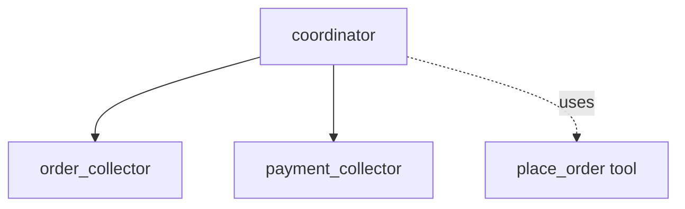

# ADK Task as Sub-agent Sample

## Overview

This sample demonstrates how a "task mode" agent can act as a sub-agent to an LLM agent, effectively extracting structured data from a conversational flow.

The main agent (`coordinator`) delegates interactions to two sub-agents:

1. `order_collector`: A task agent that collects the user's food order (from a menu of Pizza, Burger, Salad) and returns a structured list of selected items as a `list[OrderItem]`.
1. `payment_collector`: A task agent that collects the user's credit card and CVV information, returning a `PaymentInfo` object.

Once the tasks are completed, the coordinator automatically uses a `place_order` tool with the structured data returned by both agents.

## Sample Inputs

- `I would like to order some food please.`

- `I want 2 pizzas and 1 salad.`

- `My credit card is 1234-5678-9012-3456 and my CVV is 123.`

## Graph



## How To

1. Define a sub-agent with `mode="task"` and an output schema:

   ```python
   order_collector = Agent(
       name="order_collector",
       mode="task",
       output_schema=list[OrderItem],
       ...
   )
   ```

1. Assign it to a parent agent and use it in the instruction to collect the information:

   ```python
   coordinator = Agent(
       sub_agents=[order_collector],
       instruction="Delegate using `order_collector`...",
       ...
   )
   ```

## Related Guides

- [LlmAgent Task Mode](../../../../docs/guides/agents/llm_agent/task.md) - Guide explaining the behavior and configuration of task-mode agents.

## Weilliptic setup and usage

This recipe uses the [`weil-ai`](https://pypi.org/project/weil-ai/) package. Run the commands below from this folder.

### Setup

1. Install the dependencies:

   ```bash
   uv sync
   ```

2. Create the env file and fill in the values:

   ```bash
   cp .env.example .env
   ```

   Variables you must set: `OPENAI_API_KEY`. The other variables in the file have working defaults.

3. Replace the placeholder `identity="weil_xxxx"` in `app/agent.py` with your own Weilliptic identity. It is hardcoded there, and WeilChain rejects the placeholder at startup. See [Generate an agent identity](../weilliptic-integration/README.md#generate-an-agent-identity).

### Run locally

```bash
uv run adk web
```

Open <http://localhost:8000> and pick `app` from the agent list.

### Run with Docker

```bash
docker build -t weil-task-sub-agent .
docker run --rm --env-file .env -p 8080:8080 weil-task-sub-agent
```

The image serves the app on port 8080 (`/list-apps` lists it). Credentials are never copied into the image; they come from `--env-file` at run time.

### A2A server

The agent also builds a Weil-secured A2A app, `a2a_app`, which rejects requests that do not carry valid Weil signature headers. It advertises port 8004:

```bash
docker run --rm --env-file .env -p 8004:8004 weil-task-sub-agent \
  uv run uvicorn app.agent:a2a_app --host 0.0.0.0 --port 8004
```

See the [Weilliptic integration guide](../weilliptic-integration/README.md) for how the security hooks work.
