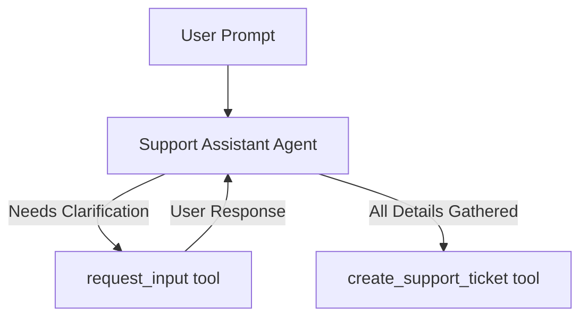

# Request Input Tool Sample

## Overview

This sample demonstrates how an LLM agent can proactively request clarification or confirmation from the user using the built-in `request_input` tool without losing its context/flow.

It showcases a highly realistic support assistant that dynamically constructs a JSON schema to only ask for missing details when creating IT support tickets.

## Sample Inputs

- `I want to file a technical ticket for a database crash.`

  The agent will analyze the prompt, identify that the `title` and `category` are already provided, and dynamically call `request_input` with a schema requesting only `description` and `priority`.

- `File a priority HIGH technical ticket titled database crash explained as the MySQL server throwing OOM errors.`

  The agent has all required details and will call `create_support_ticket` immediately without needing clarification.

## Graph



## How To

This sample uses **Pattern B: Standalone Agents** with the `request_input` tool:

1. **Import `request_input`**:

   ```python
   from google.adk.tools import request_input
   ```

1. **Add it to the LLM Agent's tools list**:

   ```python
   root_agent = Agent(
       name="support_assistant_agent",
       tools=[create_support_ticket, request_input],
       ...
   )
   ```

When the LLM decides it needs clarification, it calls `request_input` with a question and a dynamic `response_schema`. The ADK framework automatically intercepts this, yields a long-running interrupt to the client, and injects the user's reply back as a `FunctionResponse` into the LLM's chat history.

## Weilliptic setup and usage

This project uses the [`weil-ai`](https://pypi.org/project/weil-ai/) package. Run the commands below from the recipe root, `contrib/python/weilliptic-integration`, unless a block starts with `cd`.

### Setup

1. Install the dependencies (`weil-ai` and `weil-wallet` come from PyPI):

   ```bash
   pip install -r requirements.txt
   ```

2. Create this project's env file and fill in the values:

   ```bash
   cp hitl/request_input_tool/.env.example hitl/request_input_tool/.env
   ```

   Variables it needs: `OPENAI_API_KEY`.

3. Replace the placeholder `identity="weil_xxxx"` in `hitl/request_input_tool/agent.py` with your own Weilliptic identity. It is hardcoded there, not read from the environment, and WeilChain rejects the placeholder at startup.

### Run locally

```bash
adk web hitl --port 8000
```

ADK loads this project's `.env` automatically. Open <http://localhost:8000> and pick `request_input_tool` from the agent list.

### Run with Docker

From the recipe root:

```bash
docker build -f hitl/request_input_tool/Dockerfile -t request_input_tool .
docker run --rm --env-file hitl/request_input_tool/.env -p 8000:8000 -p 8009:8009 request_input_tool
```

Credentials are never copied into the image; they come from `--env-file` at run time.

### A2A server (port 8009)

The agent also exposes a Weil-secured A2A app, `a2a_app`. Inbound requests must carry Weil signature headers; unsigned requests are rejected.

```bash
docker run --rm --env-file hitl/request_input_tool/.env -p 8009:8009 request_input_tool \
  uvicorn request_input_tool.agent:a2a_app --host 0.0.0.0 --port 8009
```

See the [recipe README](../../README.md) for how the Weilliptic integration works.
