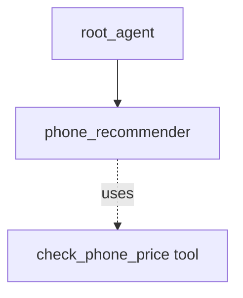

# ADK Single-turn Agent as Sub-agent Sample

## Overview

This sample demonstrates how a "single_turn" mode agent can act as an autonomous sub-agent to an LLM agent, utilizing schemas and tools without ever interacting with the user.

**Note**: This is the recommended mechanism to replace the older `AgentTool` pattern. Unlike `AgentTool`, using a `single_turn` sub-agent preserves the sub-agent's internal interactions (like tool calls) in the session history.

Single-turn agents are designed to execute their function fully in one prompt-response cycle. In this sample:

1. `phone_recommender`: A single-turn agent that receives structured input (`UserPreferences`), uses a mocked tool (`check_phone_price`), and returns structured output (`PhoneRecommendation`).
1. `root_agent`: The main agent that interacts with the user, translates their natural language request into the structured `UserPreferences`, and delegates to `phone_recommender`.

## Sample Inputs

- `I need a phone mostly for gaming. I have about $1000 to spend.`

- `What is a good cheap phone from Google for basic tasks?`

- `I love photography but prefer smaller phones. My budget is $600.`

## Graph



## How To

1. Define a sub-agent with `mode="single_turn"`, `input_schema`, `output_schema`:

   ```python
   phone_recommender = Agent(
       name="phone_recommender",
       mode="single_turn",
       input_schema=UserPreferences,
       output_schema=PhoneRecommendation,
       tools=[check_phone_price],
       ...
   )
   ```

1. Assign it to a parent agent:

   ```python
   root_agent = Agent(
       sub_agents=[phone_recommender],
       ...
   )
   ```

## Related Guides

- [LlmAgent Single-Turn Mode](../../../../docs/guides/agents/llm_agent/single_turn.md) - Guide explaining the behavior and configuration of single-turn agents.

## Weilliptic setup and usage

This project uses the [`weil-ai`](https://pypi.org/project/weil-ai/) package. Run the commands below from the recipe root, `contrib/python/weilliptic-integration`, unless a block starts with `cd`.

### Setup

1. Install the dependencies (`weil-ai` and `weil-wallet` come from PyPI):

   ```bash
   pip install -r requirements.txt
   ```

2. Create this project's env file and fill in the values:

   ```bash
   cp multi_agent/single_turn_sub_agent/.env.example multi_agent/single_turn_sub_agent/.env
   ```

   Variables it needs: `OPENAI_API_KEY`.

3. Replace the placeholder `identity="weil_xxxx"` in `multi_agent/single_turn_sub_agent/agent.py` with your own Weilliptic identity. It is hardcoded there, not read from the environment, and WeilChain rejects the placeholder at startup.

### Run locally

```bash
adk web multi_agent --port 8000
```

ADK loads this project's `.env` automatically. Open <http://localhost:8000> and pick `single_turn_sub_agent` from the agent list.

### Run with Docker

From the recipe root:

```bash
docker build -f multi_agent/single_turn_sub_agent/Dockerfile -t single_turn_sub_agent .
docker run --rm --env-file multi_agent/single_turn_sub_agent/.env -p 8000:8000 -p 8003:8003 single_turn_sub_agent
```

Credentials are never copied into the image; they come from `--env-file` at run time.

### A2A server (port 8003)

The agent also exposes a Weil-secured A2A app, `a2a_app`. Inbound requests must carry Weil signature headers; unsigned requests are rejected.

```bash
docker run --rm --env-file multi_agent/single_turn_sub_agent/.env -p 8003:8003 single_turn_sub_agent \
  uvicorn single_turn_sub_agent.agent:a2a_app --host 0.0.0.0 --port 8003
```

See the [recipe README](../../README.md) for how the Weilliptic integration works.
