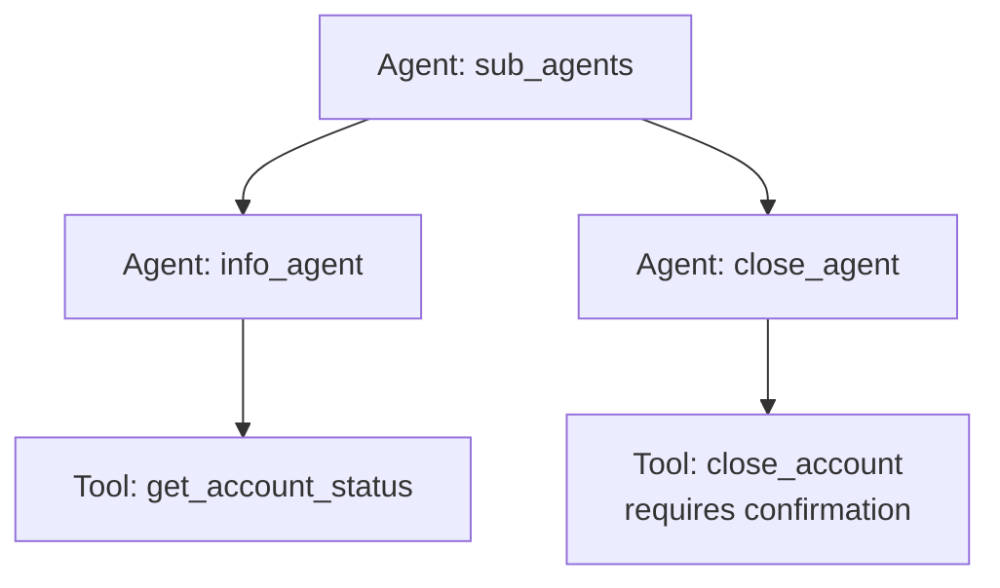

# ADK Agent Sub-Agents Sample

## Overview

This sample demonstrates how to create a hierarchical agent setup using sub-agents in the **ADK** framework, and also showcases how to use tool confirmation.

It defines a root `Agent` named `sub_agents` that coordinates two sub-agents: `info_agent` and `close_agent`.

- `info_agent` is equipped with a tool to check account status.
- `close_agent` is equipped with a tool to close accounts, which requires user confirmation before execution.

The root agent delegates tasks to these sub-agents based on the user's prompt. This sample illustrates how to modularize capabilities into separate agents instead of combining all tools on a single agent.

## Sample Inputs

- `Check the status of account ACC-123.`

- `Close account ACC-123.`

- `Check if account ACC-123 is active, and if so, close it.`

## Graph



## How To

1. Define the specific tools for each sub-agent:

   ```python
   def get_account_status(account_id: str) -> str:
       """Gets the status of a bank account."""
       return f"Account {account_id} is active."

   def close_account(account_id: str) -> str:
       """Closes a bank account."""
       return f"Account {account_id} has been closed."
   ```

1. Register tools to their respective sub-agents, using `FunctionTool` for confirmation:

   ```python
   from google.adk.agents import Agent
   from google.adk.tools.function_tool import FunctionTool

   info_agent = Agent(
       name="info_agent",
       description="An agent that can check account status.",
       tools=[get_account_status],
   )

   close_agent = Agent(
       name="close_agent",
       description="An agent that can close accounts.",
       tools=[FunctionTool(func=close_account, require_confirmation=True)],
   )
   ```

1. Add the sub-agents to the root agent's `sub_agents` list:

   ```python
   root_agent = Agent(
       name="sub_agents",
       sub_agents=[info_agent, close_agent],
   )
   ```

## Weilliptic setup and usage

This project uses the [`weil-ai`](https://pypi.org/project/weil-ai/) package. Run the commands below from the recipe root, `contrib/python/weilliptic-integration`, unless a block starts with `cd`.

### Setup

1. Install the dependencies (`weil-ai` and `weil-wallet` come from PyPI):

   ```bash
   pip install -r requirements.txt
   ```

2. Create this project's env file and fill in the values:

   ```bash
   cp multi_agent/sub_agents/.env.example multi_agent/sub_agents/.env
   ```

   Variables it needs: `OPENAI_API_KEY`.

3. Replace the placeholder `identity="weil_xxxx"` in `multi_agent/sub_agents/agent.py` with your own Weilliptic identity. It is hardcoded there, not read from the environment, and WeilChain rejects the placeholder at startup.

### Run locally

```bash
adk web multi_agent --port 8000
```

ADK loads this project's `.env` automatically. Open <http://localhost:8000> and pick `sub_agents` from the agent list.

### Run with Docker

From the recipe root:

```bash
docker build -f multi_agent/sub_agents/Dockerfile -t sub_agents .
docker run --rm --env-file multi_agent/sub_agents/.env -p 8000:8000 -p 8002:8002 sub_agents
```

Credentials are never copied into the image; they come from `--env-file` at run time.

### A2A server (port 8002)

The agent also exposes a Weil-secured A2A app, `a2a_app`. Inbound requests must carry Weil signature headers; unsigned requests are rejected.

```bash
docker run --rm --env-file multi_agent/sub_agents/.env -p 8002:8002 sub_agents \
  uvicorn sub_agents.agent:a2a_app --host 0.0.0.0 --port 8002
```

See the [recipe README](../../README.md) for how the Weilliptic integration works.
