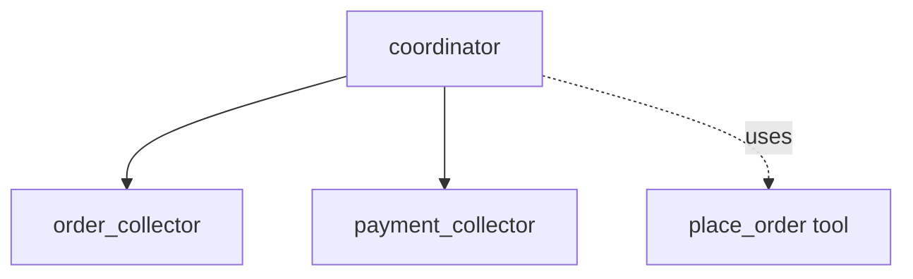

# ADK Task as Sub-agent Sample

## Overview

This sample demonstrates how a "task mode" agent can act as a sub-agent to an LLM agent, effectively extracting structured data from a conversational flow.

The main agent (`coordinator`) delegates interactions to two sub-agents:

1. `order_collector`: A task agent that collects the user's food order (from a menu of Pizza, Burger, Salad) and returns a structured list of selected items as a `list[OrderItem]`.
1. `payment_collector`: A task agent that collects the user's credit card and CVV information, returning a `PaymentInfo` object.

Once the tasks are completed, the coordinator automatically uses a `place_order` tool with the structured data returned by both agents.

## Sample Inputs

- `I would like to order some food please.`

- `I want 2 pizzas and 1 salad.`

- `My credit card is 1234-5678-9012-3456 and my CVV is 123.`

## Graph



## How To

1. Define a sub-agent with `mode="task"` and an output schema:

   ```python
   order_collector = Agent(
       name="order_collector",
       mode="task",
       output_schema=list[OrderItem],
       ...
   )
   ```

1. Assign it to a parent agent and use it in the instruction to collect the information:

   ```python
   coordinator = Agent(
       sub_agents=[order_collector],
       instruction="Delegate using `order_collector`...",
       ...
   )
   ```

## Related Guides

- [LlmAgent Task Mode](../../../../docs/guides/agents/llm_agent/task.md) - Guide explaining the behavior and configuration of task-mode agents.

## Weilliptic setup and usage

This project uses the [`weil-ai`](https://pypi.org/project/weil-ai/) package. Run the commands below from the recipe root, `contrib/python/weilliptic-integration`, unless a block starts with `cd`.

### Setup

1. Install the dependencies (`weil-ai` and `weil-wallet` come from PyPI):

   ```bash
   pip install -r requirements.txt
   ```

2. Create this project's env file and fill in the values:

   ```bash
   cp multi_agent/task_sub_agent/.env.example multi_agent/task_sub_agent/.env
   ```

   Variables it needs: `OPENAI_API_KEY`.

3. Replace the placeholder `identity="weil_xxxx"` in `multi_agent/task_sub_agent/agent.py` with your own Weilliptic identity. It is hardcoded there, not read from the environment, and WeilChain rejects the placeholder at startup.

### Run locally

```bash
adk web multi_agent --port 8000
```

ADK loads this project's `.env` automatically. Open <http://localhost:8000> and pick `task_sub_agent` from the agent list.

### Run with Docker

From the recipe root:

```bash
docker build -f multi_agent/task_sub_agent/Dockerfile -t task_sub_agent .
docker run --rm --env-file multi_agent/task_sub_agent/.env -p 8000:8000 -p 8004:8004 task_sub_agent
```

Credentials are never copied into the image; they come from `--env-file` at run time.

### A2A server (port 8004)

The agent also exposes a Weil-secured A2A app, `a2a_app`. Inbound requests must carry Weil signature headers; unsigned requests are rejected.

```bash
docker run --rm --env-file multi_agent/task_sub_agent/.env -p 8004:8004 task_sub_agent \
  uvicorn task_sub_agent.agent:a2a_app --host 0.0.0.0 --port 8004
```

See the [recipe README](../../README.md) for how the Weilliptic integration works.
