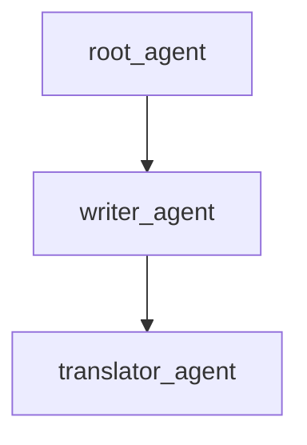

# Three Layer Transfer Sample

## Overview

This sample demonstrates a three-layer multi-agent system built with the ADK Python toolkit, showcasing structured double-round-trip hierarchical transfers.

## Sample Inputs

- `Hello, who are you?`
- `Can you write a short story about a lost kitten?`
- `Please translate it into Spanish.`
- `Looks great! Let's return to the project coordinator.`

## Graph



## How To

This sample demonstrates:

1. Root delegating to middle-child node `writer_agent`.
1. `writer_agent` delegating to leaf-grandchild node `translator_agent`.
1. Grandchild returning back to the parent `writer_agent`.
1. Parent returning back to the root coordinator `root_agent`.

## Weilliptic setup and usage

This project uses the [`weil-ai`](https://pypi.org/project/weil-ai/) package. Run the commands below from the recipe root, `contrib/python/weilliptic-integration`, unless a block starts with `cd`.

### Setup

1. Install the dependencies (`weil-ai` and `weil-wallet` come from PyPI):

   ```bash
   pip install -r requirements.txt
   ```

2. Create this project's env file and fill in the values:

   ```bash
   cp multi_agent/three_layer_transfer/.env.example multi_agent/three_layer_transfer/.env
   ```

   Variables it needs: `OPENAI_API_KEY`.

3. Replace the placeholder `identity="weil_xxxx"` in `multi_agent/three_layer_transfer/agent.py` with your own Weilliptic identity. It is hardcoded there, not read from the environment, and WeilChain rejects the placeholder at startup.

### Run locally

```bash
adk web multi_agent --port 8000
```

ADK loads this project's `.env` automatically. Open <http://localhost:8000> and pick `three_layer_transfer` from the agent list.

### Run with Docker

From the recipe root:

```bash
docker build -f multi_agent/three_layer_transfer/Dockerfile -t three_layer_transfer .
docker run --rm --env-file multi_agent/three_layer_transfer/.env -p 8000:8000 -p 8005:8005 three_layer_transfer
```

Credentials are never copied into the image; they come from `--env-file` at run time.

### A2A server (port 8005)

The agent also exposes a Weil-secured A2A app, `a2a_app`. Inbound requests must carry Weil signature headers; unsigned requests are rejected.

```bash
docker run --rm --env-file multi_agent/three_layer_transfer/.env -p 8005:8005 three_layer_transfer \
  uvicorn three_layer_transfer.agent:a2a_app --host 0.0.0.0 --port 8005
```

See the [recipe README](../../README.md) for how the Weilliptic integration works.
